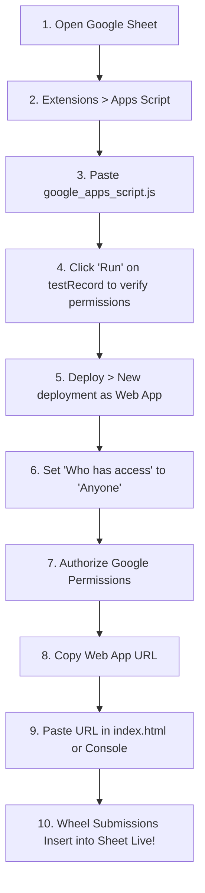

# 🚀 Poojra Silvassa - Google Sheet Integration Master Plan

> **Why did data not show in the spreadsheet yet?**  
> Google Sheets does not allow public websites to write data directly into a spreadsheet URL (`https://docs.google.com/spreadsheets/d/...`) for security reasons.  
> To save rows automatically, Google requires a **Google Apps Script Web App** (`https://script.google.com/macros/s/.../exec`). This lightweight backend runs inside your Google account, receives data from the landing page, and inserts rows into your sheet.

---

## 📌 Target Spreadsheet Information

- **Spreadsheet ID:** `1Cfo54t4sB13_CZH7hRMULyS5CfM39QGJcM4mmNbPvJk`
- **Spreadsheet Direct URL:**  
  [https://docs.google.com/spreadsheets/d/1Cfo54t4sB13_CZH7hRMULyS5CfM39QGJcM4mmNbPvJk/edit?gid=0#gid=0](https://docs.google.com/spreadsheets/d/1Cfo54t4sB13_CZH7hRMULyS5CfM39QGJcM4mmNbPvJk/edit?gid=0#gid=0)
- **Live Deployed Web App URL:**  
  `https://script.google.com/macros/s/AKfycbxW5CruA8vdD0kVy5u6opTB8EdUPGxdOvX4Tc2dcbaNnQG6CuB8st8HSwC_l9WFDERz/exec`
- **Target Columns in 1st Sheet:**
  1. `Timestamp`
  2. `Full Name`
  3. `Mobile Number`
  4. `Brand Name`
  5. `Spin Result`

---

## 📋 Complete Step-by-Step Deployment Plan



---

### Step 1: Open Google Apps Script
1. Open your target spreadsheet in Chrome:  
   👉 [**Click here to open your Google Sheet**](https://docs.google.com/spreadsheets/d/1-X2xESGDHWeRGhBrs6UW4himc7y8Ks-i3G8IJxGbMWY/edit?usp=drivesdk)
2. In the top Google Sheets menu bar, click:  
   **Extensions** ➔ **Apps Script**  
   *(A new browser tab will open with the code editor)*.

---

### Step 2: Paste the Backend Script
1. Inside the Apps Script editor, you will see a default code block:
   ```javascript
   function myFunction() {
   }
   ```
2. Select everything (`Ctrl + A`) and delete it (`Backspace` / `Delete`).
3. Open the file [`google_apps_script.js`](./google_apps_script.js) in this project.
4. Copy its entire content (`Ctrl + A`, then `Ctrl + C`).
5. Paste it into the Apps Script editor (`Ctrl + V`).
6. Click the **Save** icon (diskette icon) or press `Ctrl + S`.
7. Name the project at the top-left: `Poojra Silvassa Webhook`.

---

### Step 3: Run the 1-Click Verification Test (`testRecord`)
Before deploying, verify that the script can access your sheet and write rows:
1. In the toolbar at the top of Apps Script, find the function dropdown (it currently says `doPost` or `doGet`).
2. Click the dropdown and select **`testRecord`**.
3. Click the **▶ Run** button.
4. A popup will say **"Authorization required"**:
   - Click **Review permissions**.
   - Select your Google account.
   - You will see: *"Google hasn't verified this app"*.
   - Click **Advanced** (small grey text at bottom-left).
   - Click **Go to Poojra Silvassa Webhook (unsafe)**.
   - Click **Allow**.
5. The execution log at the bottom will output:
   ```
   --- Starting Test Submission ---
   Result: {"status":"success","message":"Customer entry added successfully to Google Sheet.", ...}
   ```
6. **Switch back to your Google Sheet tab!**  
   You will now see a new row with:  
   `Test Customer (Poojra)` | `9876543210` | `Apple iPhone 15` | `Neckband Wireless Hi-Bass`!  
   *(This proves your script has full write permissions!)*

---

### Step 4: Deploy as a Web App (Critical Settings)
1. At the top-right corner of the Apps Script window, click the blue **Deploy** button.
2. Select **New deployment**.
3. Next to "Select type", click the **⚙️ Gear icon** and choose **Web app**.
4. Fill in the deployment form:
   - **Description:** `Poojra Silvassa Live Webhook v1`
   - **Execute as:** **`Me (your-email@gmail.com)`**
   - **Who has access:** ⚠️ **`Anyone`**  
     *(CRITICAL: You MUST choose "Anyone". Do NOT choose "Only myself" or "Anyone with Google Account", otherwise website visitors will be blocked by Google).*
5. Click **Deploy**.

---

### Step 5: Copy Your Deployed Web App URL
1. Once deployed, Google will present a window titled **Deployment configuration**.
2. Under **Web app**, copy the **URL**.  
   It will look like this:  
   `https://script.google.com/macros/s/AKfycbx.../exec`  
   *(Make sure it ends with `/exec`, not `/edit`)*.

---

### Step 6: Connect the Web App URL to the Landing Page

You have **two super easy options**:

#### Option A: Paste in `index.html` (Permanent for all users)
1. Open [`index.html`](./index.html).
2. The Web App URL is already configured in line **1201**:
   ```javascript
   const GOOGLE_APPS_SCRIPT_WEBAPP_URL = 'https://script.google.com/macros/s/AKfycbxW5CruA8vdD0kVy5u6opTB8EdUPGxdOvX4Tc2dcbaNnQG6CuB8st8HSwC_l9WFDERz/exec';
   ```
3. All form submissions from visitors will now automatically save directly to the Google Sheet!

#### Option B: Set via Developer Console (Instant without code changes)
1. Open your landing page in Chrome: `http://localhost:8000/`.
2. Press `F12` to open Developer Tools, then click the **Console** tab.
3. Type:
   ```javascript
   setGoogleSheetUrl("https://script.google.com/macros/s/AKfycb.../exec")
   ```
4. Press `Enter`. The console will confirm:  
   `✅ Google Apps Script Web App URL updated!`

---

## 🧪 Step 7: Live End-to-End Verification

1. On your landing page, click **SPIN NOW**.
2. Wait for the wheel to land on a prize.
3. In the registration form, enter real test details:
   - **Full Name:** `Himanshu`
   - **Mobile Number:** `9328603748`
   - **Brand Name:** `IPHONE 15 PRO`
4. Click **🎁 Submit Now**.
5. Switch to your Google Sheet:  
   👉 A new row will appear in real time with the exact name, phone, brand, prize, and timestamp!

---

## ⚠️ Troubleshooting & Common Mistakes

| Issue | Cause | Fix |
| :--- | :--- | :--- |
| **Data not showing in sheet** | Web App not deployed or "Execute as" wrong | Deploy as Web App, set "Execute as: Me" and "Who has access: Anyone". |
| **Authorization error (401 / 403)** | "Who has access" was set to "Only myself" | In Apps Script, click **Deploy > Manage deployments > Edit > Who has access: Anyone**, then click **Deploy**. |
| **Url ends with `/dev` instead of `/exec`** | Test deployment URL was copied | In Apps Script, always copy the URL from **New deployment** or **Manage deployments** ending in `/exec`. |
| **Duplicates or Race Conditions** | Fast double clicks by users | Handled automatically! The script uses Google's `LockService` and duplicate coupon verification to ensure zero duplicate rows. |
